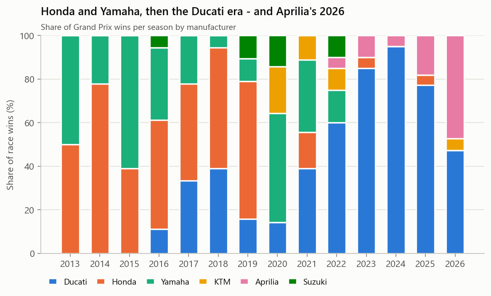
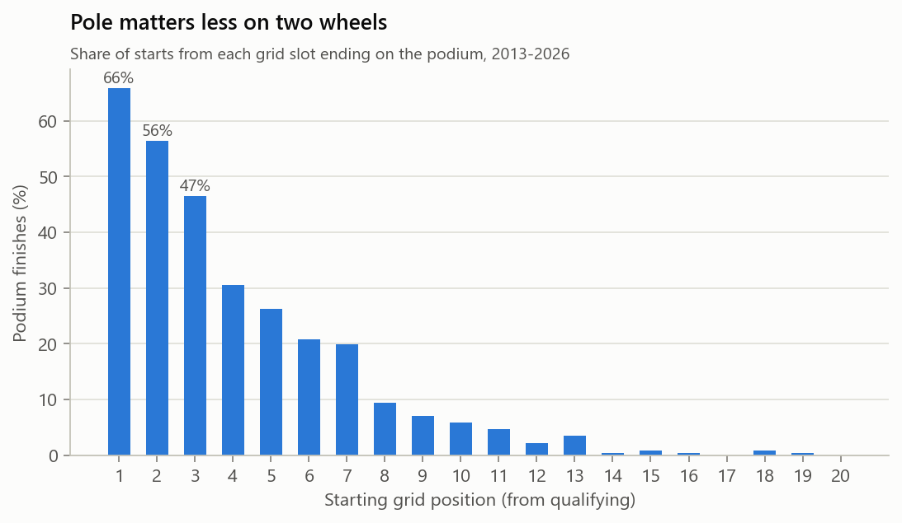
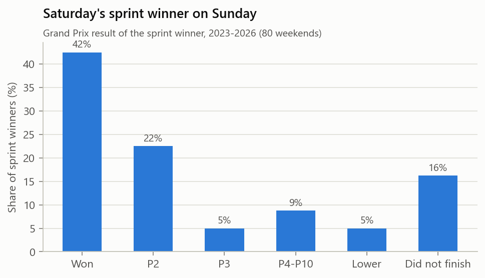
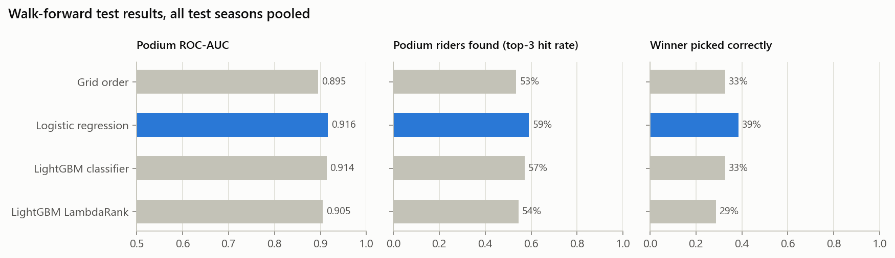

# MotoGP Performance Analytics

[](https://github.com/manookello/motogp-performance-analytics/actions/workflows/ci.yml)


Fourteen seasons of MotoGP (2013–2026, **260 Grands Prix, 5,860 rider-race starts**) turned into
an analysis of manufacturer eras, qualifying, crashes, sprints and rain. It also includes
machine-learning models for **podium probability**, **finishing order** and **crash risk**, all
validated walk-forward on seasons they never saw.



## Highlights

**Analysis**
- **Ducati's era, and Aprilia's 2026.** Honda and Yamaha shared the 2010s. Ducati then won
  17, 19 and 17 Grands Prix in 2023–2025. In 2026 Aprilia matched Ducati with 9 wins each.
- **Pole matters far less than in F1.** From grid P1 a MotoGP rider wins 38% of the time and
  reaches the podium 66% of the time. In the [companion F1 project](https://github.com/manookello/f1-race-outcome-predictor)
  the figures are 55% and 81%.
- **Rain scrambles the order but doesn't cause more crashes.** In wet races the grid-to-finish
  rank correlation drops from 0.55 to 0.38, and only 48% of winners start on the front row
  (73% in the dry). The DNF rate is *not* higher (18.7% wet vs 19.4% dry): riders back off.
- **Crashes happen in the pack.** The DNF rate rises from 15.5% for front-row starters to 21.4%
  from 19th or lower. Since 2019 Honda riders have retired most often (23%) and Yamaha riders least (17%).
- **Saturday's sprint winner** goes on to win on Sunday 42% of the time. They retire 16% of the
  time, almost as often as they finish second.

<p align="center">
  
  
</p>

**Models.** Out-of-sample results for 2022–2026 (101 races). Each season was predicted by models
trained only on earlier seasons.

| Model | Podium ROC-AUC | Top-3 hit rate | Winner accuracy | Spearman (full order) |
|---|---|---|---|---|
| Grid order (baseline) | 0.895 | 53.5% | 32.7% | 0.502 |
| **Logistic regression** | **0.916** | **59.1%** | **38.6%** | 0.519 |
| LightGBM classifier | 0.914 | 57.1% | 32.7% | 0.515 |
| LightGBM LambdaRank | 0.905 | 54.5% | 28.7% | **0.530** |

- Unlike F1, where the grid is very hard to beat, **the models beat the grid in MotoGP**. Logistic
  regression wins on every pooled podium metric. The gain is concentrated in 2024–2026
  (e.g. AUC 0.945 vs 0.894 in 2024).
- After grid position, the most important features are the rider's **recent podium rate** and
  the **same-weekend sprint result**.
- **Crash risk is close to unpredictable before the start.** The DNF model reaches PR-AUC 0.260,
  against 0.191 for the base rate. That is no better than simply using the rider's own long-run
  DNF rate (0.257). Once you know who is riding, the rest is first-lap chaos and luck.



## Data

- **Source:** the public results API that powers motogp.com
  (`api.motogp.pulselive.com/motogp/v1/results`). This API is **unofficial and undocumented**.
  The client in `motogp_analytics.data` caches every response on disk, throttles to about 2
  requests per second and backs off on errors.
- **Sessions kept:** for each MotoGP-class event, Q1, Q2, the Sprint (2023+) and the Race, with
  track/air temperature, humidity and the wet/dry state.
- **Cleaning:**
  - Restarted (red-flagged) races appear twice, and only the official restart is kept.
  - The grid is rebuilt from Q2 (P1–12) plus Q1 (P3+ → 13th onward). Grid penalties are not in
    the API.
  - Non-finishers are ranked behind classified riders by laps completed.
  - CRT/Open-class chassis from 2013–2015 (FTR, ART, Suter…) are grouped as "Other".
  - Two events have no race classification (2018 British GP, cancelled; 2026 Australian GP) and
    are excluded from race-level analysis.

## Method

- **Features** (`src/motogp_analytics/features.py`). There are 19 pre-race features:
  - grid, qualifying gap to pole and the same-weekend sprint result or crash;
  - rolling rider form, podium and DNF rates, and championship position before the race;
  - manufacturer points per bike and best finish over the last 5 races;
  - rider history at the circuit;
  - track temperature, the wet flag and the round number.

  Every rolling window uses `shift(1)`, and unit tests guard against leakage.
- **Models.**
  - Outcomes: logistic regression, a LightGBM podium classifier and LightGBM LambdaRank, the
    same design as the F1 project, with a grid-order baseline.
  - Crash risk: a heavily regularized LightGBM DNF classifier, compared with the base rate and
    with the rider's own DNF rate.
- **Validation.** Walk-forward by season, testing on 2022–2026. Hyperparameters were chosen on
  validation seasons 2019–2021.

## Project structure

```
├── app/streamlit_app.py      # season explorer, manufacturers, rider head-to-head, race predictor
├── data/processed/           # events, sessions, results, features, predictions, metrics
├── models/motogp_models.joblib
├── notebooks/
│   ├── 01_data_collection.ipynb
│   ├── 02_eda.ipynb          # eras, grid, crashes, wet vs dry, sprint, title fights
│   └── 03_modeling.ipynb     # podium / order models, calibration, importance, crash risk
├── reports/figures/
├── src/motogp_analytics/     # data, features, model, plots
└── tests/
```

## Quickstart

```bash
git clone https://github.com/manookello/motogp-performance-analytics.git
cd motogp-performance-analytics
python -m venv .venv && source .venv/bin/activate   # Windows: .venv\Scripts\activate
pip install -r requirements.txt -r requirements-dev.txt
pip install -e . --no-deps

streamlit run app/streamlit_app.py
pytest

python -m motogp_analytics.data --start 2013 --end 2026   # optional: refresh from the API
```

## Limitations & next steps

- Grid penalties (e.g. long-lap or pit-lane starts) are not applied to the reconstructed grid.
- No tyre-choice data is used. Front and rear compound choice is a big factor in MotoGP races.
- The Moto2 and Moto3 classes are available from the same API (`category_prefix` in
  `build_dataset`) and could be used to model rider promotion.

## Related projects

- [f1-race-outcome-predictor](https://github.com/manookello/f1-race-outcome-predictor): the F1
  counterpart of these race-outcome models.
- [f1-vs-motogp-circuits](https://github.com/manookello/f1-vs-motogp-circuits): lap times at
  shared circuits and which championship is more competitive.
- [f1-tyre-strategy-analysis](https://github.com/manookello/f1-tyre-strategy-analysis): F1 tyre
  degradation, a strategy simulator and telemetry.

---

Data from the public motogp.com results service. This project is unofficial and not associated
with Dorna Sports or MotoGP™.
